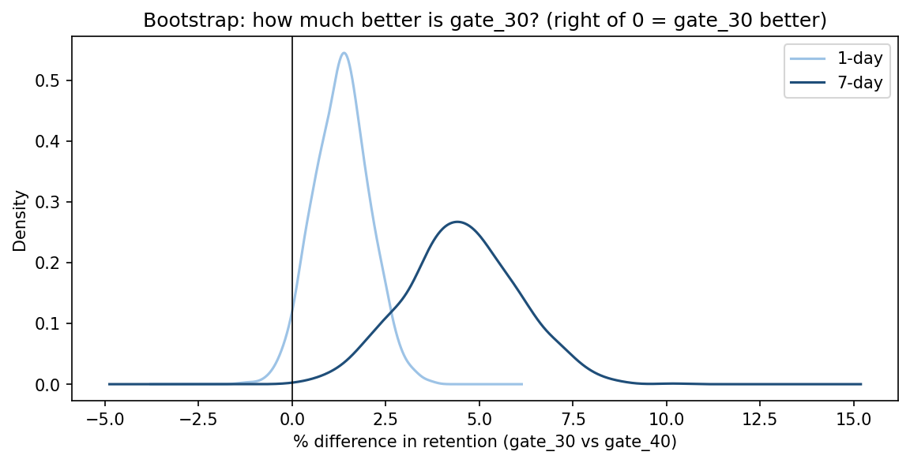
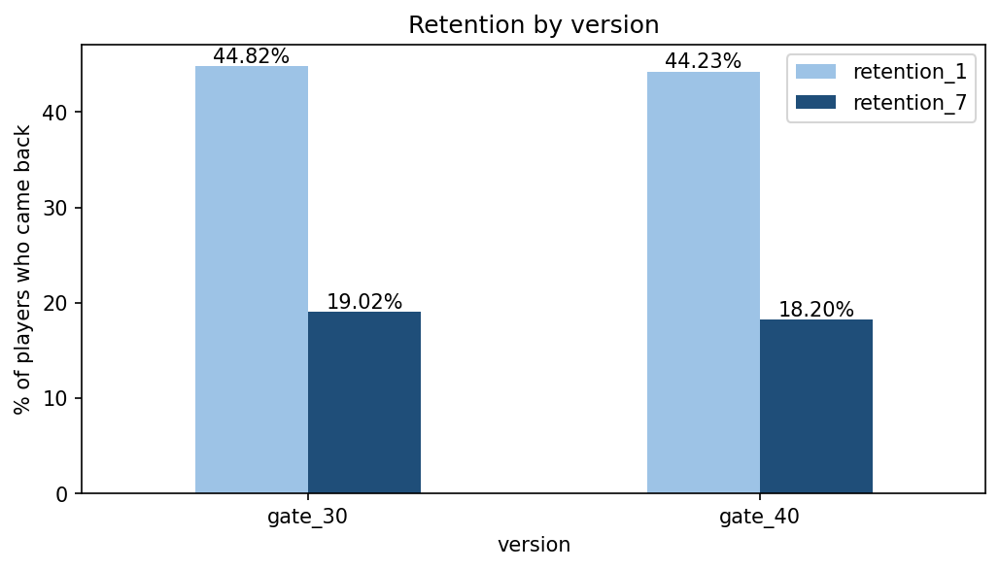
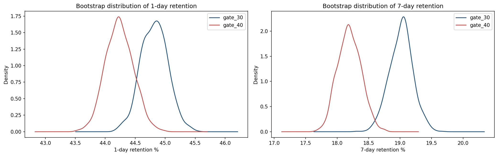
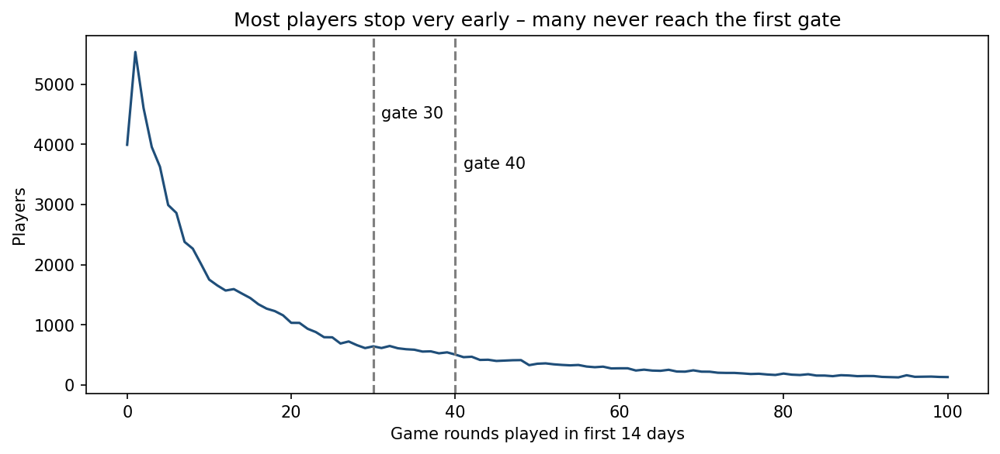
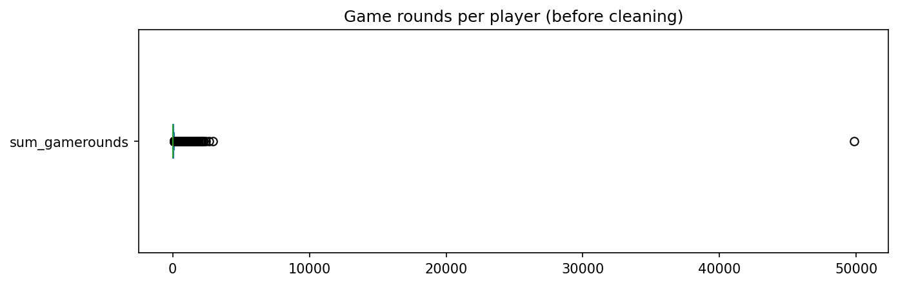

# A/B Test & Retention Analysis – Cookie Cats

**Question:** A mobile game moved its first gate (where players must wait or pay) from level 30 to level 40.
Did that change how many players come back after 1 day and 7 days – and which version should the company keep?

**Data:** [Mobile Games A/B Testing – Cookie Cats](https://www.kaggle.com/datasets/yufengsui/mobile-games-ab-testing) (Kaggle) – 90,189 players, randomly assigned to `gate_30` (control) or `gate_40` (test).

**Tools:** Python, Pandas, NumPy, SciPy (chi-square, Mann-Whitney), Matplotlib, bootstrap resampling

## Recommendation: keep the gate at level 30

Moving the gate to level 40 **significantly lowered 7-day retention** – from **19.02% to 18.20%** (≈ 4.5% fewer
returning players). The 1-day difference (44.82% vs 44.23%) is small and not statistically significant.

| Metric | gate_30 (control) | gate_40 (test) | Chi-square p-value | Bootstrap 95% interval* | P(gate_30 better) | Result |
|---|---|---|---|---|---|---|
| **7-day retention** (main) | **19.02%** | **18.20%** | **0.0016** | +1.6% to +7.5% | **100%** | **Significant** |
| 1-day retention | 44.82% | 44.23% | 0.075 | −0.1% to +2.8% | 96.4% | Not significant |

<sub>*Relative difference (gate_30 − gate_40) / gate_40 across 1,000 bootstrap samples. If the interval does not include 0 the difference is very likely real.</sub>



## Key findings

- **90,188 players** analysed after removing 1 obvious bot/data error (49,854 rounds in 14 days ≈ 3,500 a day; next highest was 2,961).
- The 7-day drop is real: **p = 0.0016** and gate_30 won in **all 1,000** bootstrap samples.
- The 1-day result is not significant because **63% of players play fewer than 30 rounds** – most players never reach either gate on day 1, so the gate position can't affect them yet. By day 7 more players have hit the gate.
- Rounds played are almost the same in both versions (median 17 vs 16, Mann-Whitney p = 0.051).
- **Limitation:** the sample ratio check shows a slight imbalance (49.6% / 50.4%, p = 0.009). It is small, but worth confirming the assignment worked before a final decision. Also, only retention was measured – not revenue or player satisfaction.

## Charts

| | |
|---|---|
|  |  |
|  |  |

## Power BI dashboard

`dashboard/powerbi/AB_Test_Dashboard.pbip` – a Power BI Project (semantic model in TMDL + report in PBIR, so it is readable and diff-able in git).

**One page – A/B Test Results:** KPI cards (players, 1-day and 7-day retention, median rounds) with a version slicer, retention by version, the bootstrap distribution of the 7-day difference, the statistical test results table, players by rounds played, and the recommendation.

**Open it:** double-click `AB_Test_Dashboard.pbip` (Power BI Desktop) → click **Refresh** on the Home tab to load the data → *File → Save as* `.pbix` if you want a single file.
Data source: cookie_cats.csv, ab_results.csv, bootstrap_samples.csv in `data/`. If you cloned the repo to a different folder: *Transform data → Edit parameters → DataFolder* → set it to your `data\` folder.

## How I did it

1. **Hypothesis first** – H0: moving the gate does not change 7-day retention; H1: it does. Main metric 7-day retention, second metric 1-day retention, α = 0.05. Written before looking at the data.
2. **Data checks** – no missing values, no duplicate users, sample ratio check (chi-square goodness-of-fit vs 50/50).
3. **Outliers** – box plot of game rounds, removed one impossible player; kept the 3,994 players with 0 rounds because they are part of the randomised population.
4. **Retention comparison** – retention % per version.
5. **Bootstrap resampling** – 1,000 resamples with replacement to get the distribution of retention for each version, the 95% interval of the difference and the probability that gate_30 is better.
6. **Chi-square test of independence** – does "came back or not" depend on the version?
7. **Recommendation** – see the final cell of the notebook.

## Project structure

```
ab-test-retention-analysis/
├── data/cookie_cats.csv
├── notebooks/ab_test.ipynb     # full analysis with outputs
├── dashboard/                  # charts used in this README
├── NOTES.md                    # every number found
├── requirements.txt
└── README.md
```

## How to run

```bash
pip install -r requirements.txt
cd notebooks
jupyter notebook ab_test.ipynb     # Run All – the bootstrap takes 1–2 minutes
```

## Interview notes

- **p-value:** if there were really no difference, how likely is a result this big just by chance. 0.0016 = very unlikely.
- **Why not just compare averages:** a 0.8-point difference could happen by luck; the tests show it most likely didn't.
- **Bootstrap vs chi-square:** bootstrap shows the full range of possible results; chi-square gives one p-value. Both agree here.
